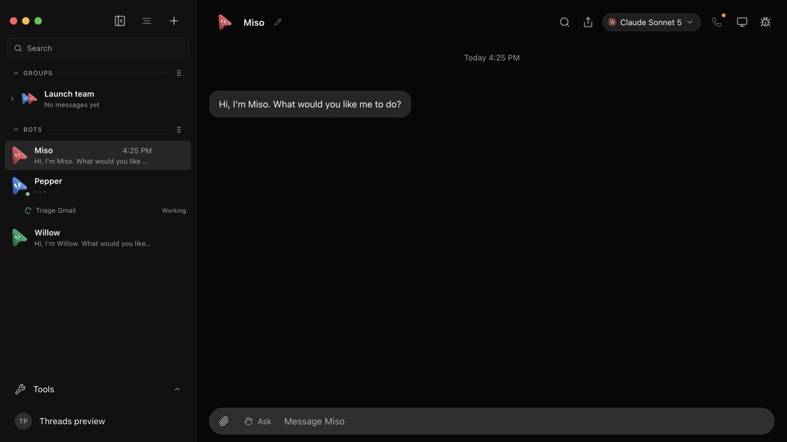
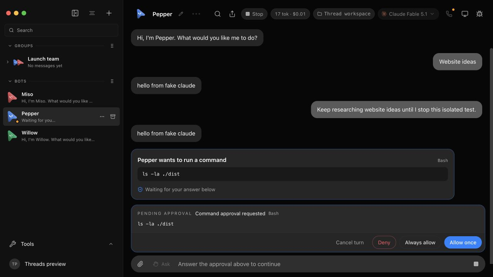

# Independent threads and sidebar

Launch the real renderer and server with only an offline provider and a
disposable data directory:

```sh
node --experimental-strip-types scripts/verify-threads.ts
```

Open the printed `previewUrl`. The fixture seeds Pepper with three threads,
two different saved model choices, and a Launch team
group with separate histories. New turns deliberately remain running so that
switching and Stop can be exercised without a real provider or account.

## Check the real UI

1. Select Pepper to open its main chat ("Website ideas"). Sibling activity
   appears in an activity row under Pepper in the sidebar: "Triage Gmail" is
   running and shows Working. Click the activity row to open Triage Gmail and
   confirm its conversation and model.
2. In Triage Gmail, the running turn remains active. Switch between Pepper's
   main chat and the active task; switching must not move messages.
3. Stop Triage Gmail using the Stop button in the chat header or composer.
   Confirm the turn stops.
4. In an idle conversation, change its model. Select another conversation and
   return; each retains its own choice. The model picker defaults to **This bot**:
   it updates the visible chat plus the default for groups and new chats,
   not existing siblings. Choose **Only this thread** for an independent
   model/account/effort override. Approval controls remain thread-scoped.
5. In Launch team (the channel/room), expand the group row to view its separate
   threads ("Launch planning", "Weekly review"). Select between them; group
   collaboration retains serialized turn behavior. Rename a channel thread
   through its row menu; verify the title updates in the sidebar.
6. Check the model selector in the header opens downward and Ask/Auto sits
   inside the composer beside attachments. Both menus must stay visible.
   Selecting a thread must not scroll the whole document or hide the header.
   Test keyboard access to row menus too.
7. In **Settings → General → Parallel threads**, select one. Start a turn in
   one conversation, then send a message in another. The latter should show
   **Queued** in the sidebar activity row and explain the free-slot wait above
   its composer, without a user message prematurely appearing in the transcript.
   Stop the active turn: the queued conversation should start and show its
   normal working animation. Raising the limit starts waiting work; lowering
   it leaves active work alone. Reload to check persistence.
8. Bot rows always open their main chat; per-bot thread trees and folder
   creation are not shown. Group/channel histories are unchanged. Background
   working, queued, unread, and waiting conversations remain reachable through
   activity controls under the bot row. Open a sibling from its activity entry,
   then click the bot's row: it returns to the conversation you last wrote in
   (the bot's main chat). Open another bot, let a reply land in the sibling it
   was left on, and check that the sibling has its own activity entry under
   that bot. Follow a notification, a thread chip or a search hit to a third
   thread of that bot: the sibling keeps its unread entry, and the third
   thread is read once open. An `openmausbot://bot/<id>` link opens the main
   chat. A row or tile with a mark on it opens the thread the mark is about
   (waiting on you, then unread, then work under way, a thread another bot
   opened included); a second click returns to the main chat.
9. Stop a running job through its activity entry while a sibling is queued;
   verify only the chosen job stops and the queued message starts normally.
   Check keyboard navigation through bot rows and activity controls.
10. In compact/quiet rows, idle message previews disappear but working,
    approval, teammate-wait, and queued status remain. Channels display their
    child rows when expanded.
HTTP tests exercise timestamp validation, explicit-null wake, persistence, and
activity-sentinel clearing. Timer unit checks cover distant deadlines and
render/effect expiry races. These checks do not prove native mobile UI or
operating-system notifications.

The last-thread walkthrough passed on 2026-09-13 in this disposable fixture:
Miso completed a fake-provider turn, its only thread was deleted through the
real confirmation dialog, the empty state survived reload, and a fresh send
completed without the old messages. Pepper's existing threads were unchanged.
Store/API regressions also verify fresh provider context, retained generated
files and rejection of running/stale deletes. Renderer regressions cover both
orders of the full response and slim event, including late old-thread messages.

For approval verification, new fake-provider launches also write fixture-only
`<thread-id>.launch.json` receipts inside the printed disposable data directory.
The live broker in their `mcpConfig.mcpServers.ogb` entry can be exercised using
the same `permission` recipe in `server/thread-capacity-api.test.ts`. Request a
synthetic approval, switch away, and navigate back using an activity control.
Answer **Allow once** and verify that broker receives the matching answer.
This proves the app's approval routing, not a real model or command execution.
Never publish the raw launch receipt: it contains short-lived fixture capabilities.

### Activity and approval walkthrough

The isolated renderer was exercised with direct bot selection, an unread sibling,
a real pending permission broker, and thread-scoped Stop. These screenshots show
the actual offline fixture, not mockups:




The offline CLI may report an interrupted subprocess when stopped; the checks
here concern ownership, state and navigation, not real-provider behavior.
The seed/setup path uses the same HTTP and control commands as the API tests.
This renderer fixture does not test a native mobile device or real computer use.

## Direct working folder and task cwd

Direct working folders pin `task.cwd` for provider sessions. Per-bot new-thread
actions are kept out of the bot menu, while `task.cwd` API persistence, dialog
validation, and navigation preservation remain tested:
```sh
pnpm exec vitest run server/task-cwd-api.test.ts src/components/NewTaskFolderDialog.test.ts src/components/Sidebar.working-folder.test.ts src/state/task-folder-navigation.test.ts
```

The API check launches the standard disposable fake-Claude fixture and proves
the selected folder reaches both its first and continued turns. It also
checks invalid paths, persistence before any message, client-scope refusal,
the unchanged default path, and rejection of `cwd` edits on existing threads.
It retains the HTTP actions, bounded transcript, waits and redacted working
directory receipts at the printed `.task-cwd.json` path. Component checks
cover initial focus, cancellation, duplicate submit prevention and recovery
from validation errors. Store/dialog tests delay HTTP responses to check
cross-bot creation, failed validation followed by cancellation, and preservation
of newer navigation. This does not test real-provider resume or a native
operating-system folder picker.

## Permanent regression checks

```sh
pnpm exec vitest run server/independent-threads-api.test.ts server/paired-thread-targets-api.test.ts server/direct-screen-settlement-api.test.ts server/bot-projects-api.test.ts server/thread-capacity-api.test.ts src/components/SidebarGroupThreadList.test.ts src/components/BotProjects.test.ts src/components/ThreadConcurrencySettings.test.ts src/components/ComposerQueuedMessages.test.ts src/lib/folder-order.test.ts src/state/store.test.ts
```

These cover thread-pinned tools and permissions, stale legacy phone requests,
bounded final screenshots, late frame rejection, retained folder histories,
and background event isolation. Capacity tests run ten distinct fake-provider
processes concurrently, queue/cancel overflow, and exercise limit changes while
an approval is pending without revoking active capabilities. Folder tests cover
validated emoji persistence, complete-order permutations and failed saves.
Integration cases launch their own fixture and
print retained JSON evidence paths next to the server logs.

Stop the foreground launcher with Ctrl-C. It closes only its own UI/server
and deletes its disposable home; the printed server log remains available.
